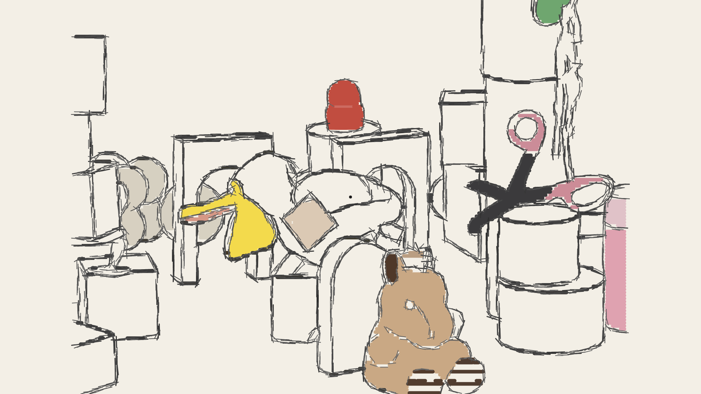

# fieldwork-drawing

Draw with code on the real [field:work](https://field-work-drawing.web.app/)
event platform.

A Playwright driver plays the app's canvas like an instrument: strokes go in
as genuine pointer gestures, so everything the platform does for a human (the
living system presets, Paint stamps, Boids, PNG export) works for code too. It
uses installed Google Chrome by default, with a fresh browser context rather
than your everyday Chrome profile; if Chrome is missing, it warns and falls
back to Playwright Chromium.
On top of the driver sit two ways in:

- **HTTP API** (`fieldwork_server.py`, `127.0.0.1:7766`) - call it from any
  script, any language.
- **MCP server** (`fieldwork_mcp.py`, 13 tools) - connect local MCP clients
  such as Antigravity, Codex, and Claude Code straight to the canvas.



*Above: a reference drawing replicated on the actual platform (the app's own
PNG export). 3,812 strokes in 5.7 seconds.*

## Quick start

```bash
pip install playwright pillow numpy 'mcp<2'
python3 -m playwright install chromium  # bundled fallback / optional choice

python3 fieldwork_server.py             # Chrome by default; API on 127.0.0.1:7766
python3 fieldwork_server.py --browser chromium  # explicitly use bundled Chromium
```

Draw a line from any code:

```bash
curl -X POST 127.0.0.1:7766/stroke -H 'Content-Type: application/json' \
  -d '{"points": [[200,200],[500,400],[900,300]], "ink": "#d53f2c", "size": 14}'
```

Chrome must be installed to use the default browser. If it is not available,
the server warns and falls back to the bundled Chromium installed above. The
visible-browser behavior is the same either way.

Then follow the [tutorial](docs/tutorial-first-drawing.md) to produce a full
drawing in about ten minutes.

## Docs (Diataxis layout)

| Kind | Doc | Use it when |
|---|---|---|
| Tutorial | [Your first drawing in 10 minutes](docs/tutorial-first-drawing.md) | Learning the system end to end |
| How-to | [Replay a photo trace onto the app](docs/how-to-replay-photo-trace.md) | Photo to ink sketch on the platform |
| How-to | [Replay ollaya decide-mode output](docs/how-to-replay-decide-mode.md) | Model-picked strokes on the platform |
| How-to | [Hook the MCP server to Antigravity, Codex, or Claude Code](docs/how-to-use-mcp.md) | Let an agent draw and see its work |
| Reference | [HTTP API](docs/reference-http-api.md) | Exact endpoint shapes |
| Reference | [MCP tools](docs/reference-mcp-tools.md) | Exact tool signatures |
| Explanation | [How the driver works, and its limits](docs/explanation-how-it-works.md) | Why synthetic gestures, honest limits |

## The event demo

```bash
# terminal 1 (Chrome by default; add --browser chromium to choose bundled Chromium)
python3 fieldwork_server.py

# terminal 2: generate a stroke list AND replay it onto the real app
python3 draw_with_code.py decide --mood "seated model, flowing ink, confident" --steps 400
curl -X POST 127.0.0.1:7766/replay -H 'Content-Type: application/json' -d @drawing.strokes.json

# photo of the model -> ink sketch strokes -> real platform
python3 draw_with_code.py trace --photo pose.jpg --out pose_sketch.png
curl -X POST 127.0.0.1:7766/replay -H 'Content-Type: application/json' -d @pose_sketch.strokes.json
```

Add `"pace_ms": 30` to the replay body to watch it draw at human speed.

Venue wifi tip: the app is a PWA with a service worker. Load it once on good
wifi and it keeps working offline; the driver only needs localhost.

## Files

- `fieldwork_server.py` - browser driver + HTTP API (the core)
- `fieldwork_mcp.py` - MCP wrapper (13 tools)
- `draw_with_code.py` - decide (ollaya `/v1/systemone`) + trace (photo to
  strokes); both also write `<out>.strokes.json` for replay
- `replicate.py` - reference-image replication pipeline (the benchmark above)

More samples: [decide mode](docs/images/sample_decide.png),
[trace mode](docs/images/sample_trace.png),
[benchmark line pass](docs/images/ref_sketch.png).
