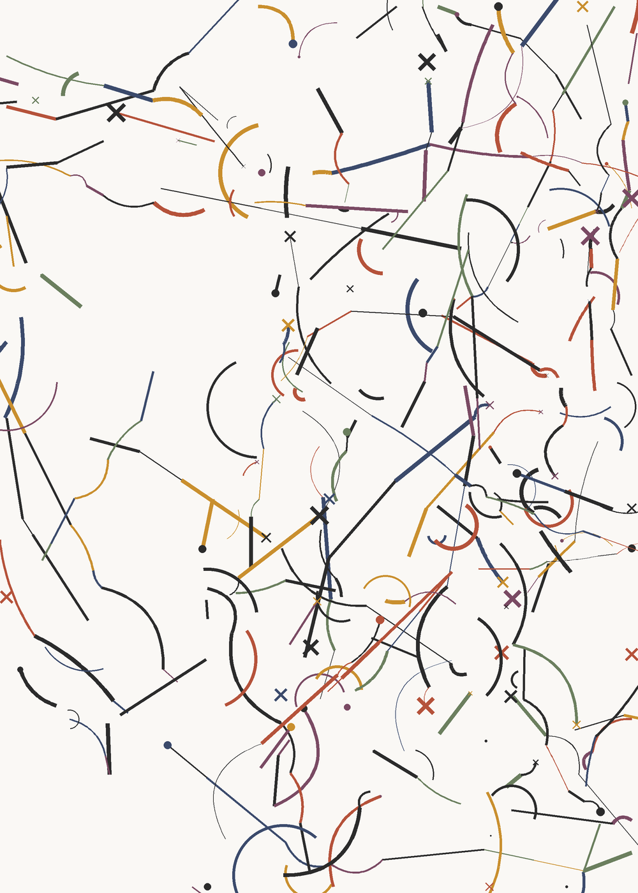

# How to replay ollaya decide-mode output

`draw_with_code.py decide` asks an ollaya decision model (`/v1/systemone`)
what to draw next, stroke by stroke, and renders the result. Every run also
writes a `.strokes.json` file you can replay onto the real platform.

## Steps

1. Start the driver:

   ```bash
   python3 fieldwork_server.py
   ```

2. Run decide mode (talks to the ollaya daemon at `127.0.0.1:11435` by
   default; falls back to random strokes if it is down):

   ```bash
   python3 draw_with_code.py decide \
     --mood "seated model, flowing ink, confident" --steps 400
   # writes drawing.png and drawing.strokes.json
   ```

3. Replay onto the app:

   ```bash
   curl -X POST 127.0.0.1:7766/replay -H 'Content-Type: application/json' \
     -d @drawing.strokes.json
   ```

## Knobs

| Flag | Default | Effect |
|---|---|---|
| `--model` | `laya:en` | Ollaya model that picks each stroke |
| `--api-base` | `http://127.0.0.1:11435` | Ollaya daemon |
| `--mood` | `calm seated pose, flowing ink, confident single strokes` | Prompt steering the picks |
| `--steps` | `400` | Number of model decisions |
| `--size WxH` | `1000x1400` | Working resolution; `/replay` rescales |
| `--scale` | `1.0` | Stroke length multiplier |
| `--save-every` | `20` | Redraw the preview every N steps |
| `--seed` | random | Fix for reproducible output |
| `--live` | off | Draw the marks on the live app after rendering (with `--speed`, `--format`, `--clear`, `--browser`, `--headless` - same family as trace `--live`) |

## Draw it live instead

Skip the curl: `--live` opens the app and draws the marks stroke by
stroke, at a watchable pace:

```bash
python3 draw_with_code.py decide \
  --mood "seated model, flowing ink, confident" --steps 400 \
  --live --speed 20 --clear
```

`--speed` is strokes per second (default 30; 0 = as fast as the app
goes), `--format` sets the page format first, `--clear` wipes the canvas
first, `--browser chromium` picks the bundled browser, `--headless`
hides the window.

## Tips

- The mood string is the steering wheel. Keep it concrete: subject, line
  quality, confidence.
- Replay with `"pace_ms": 30` during a demo so the audience watches the
  drawing emerge.
- Decide mode is the "the model decides, the platform renders" story: the
  same stroke list feeds both the standalone PNG and the real app.

Sample output: 
