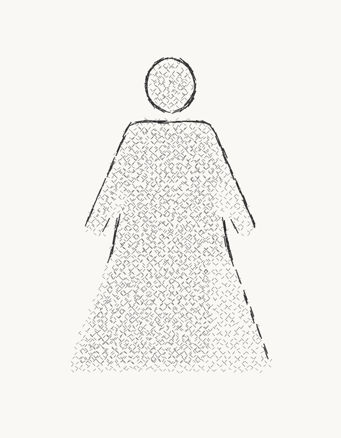

# How to replay a photo trace onto the app

Turn a photo (a pose, a sketch, a logo) into an ink drawing on the real
platform.

## Steps

1. Start the driver:

   ```bash
   python3 fieldwork_server.py
   ```

2. Trace the photo. This writes both a preview PNG and a `.strokes.json`
   replay file:

   ```bash
   python3 draw_with_code.py trace --photo sample-pose.jpg --out pose_sketch.png
   # writes pose_sketch.png and pose_sketch.strokes.json
   ```

3. Check `pose_sketch.png`. Happy with it? Replay onto the app:

   ```bash
   curl -X POST 127.0.0.1:7766/replay -H 'Content-Type: application/json' \
     -d @pose_sketch.strokes.json
   ```

   Not happy? Wipe and retry with different knobs:

   ```bash
   curl -X POST 127.0.0.1:7766/clear -d '{}'
   ```

## Draw it live instead

No server needed: `--live` opens the app in its own browser window and draws
the sketch stroke by stroke, at a pace you can watch:

```bash
python3 draw_with_code.py trace --photo pose.jpg --live --speed 20
```

The preview PNG and `.strokes.json` are still written first. The window stays
open at the end so you can admire (or export) the result; press Enter in the
terminal to close it. The drawing is scaled into the app's current page
format and letterboxed if the aspect ratios differ - pick a matching format
with `--format` (e.g. `--format 4:5` for a portrait photo).

Extra live-mode knobs:

| Flag | Default | Effect |
|---|---|---|
| `--speed N` | `30` | Strokes per second; lower looks more hand-drawn, `0` = flat out |
| `--format F` | unchanged | Set the app's page format first (`1:1`, `4:5`, `5:4`, `9:16`, `16:9`) |
| `--clear` | off | Wipe the app canvas before drawing |
| `--browser` | `chrome` | `chrome` (installed Google Chrome) or `chromium` (bundled) |
| `--headless` | off | No visible window (testing) |

## Share a redraw script

`--codegen redraw.py` writes a self-contained Python script next to the usual
outputs. Post the photo, share the script: whoever runs it (with
`fieldwork_server.py` up) redraws the picture on their own canvas through the
local API:

```bash
python3 draw_with_code.py trace --photo pose.jpg --color --codegen redraw_pose.py
# the other person:
python3 fieldwork_server.py   # terminal 1
python3 redraw_pose.py        # terminal 2, redraws via 127.0.0.1:7766/replay
```

The script is stdlib-only and carries the strokes inside itself (zlib +
base64). `PACE_MS` at the top controls draw speed; `CLEAR_FIRST = True`
wipes the canvas first.

## Techniques: Paint, Boids, opacity, living presets

The sketch is not stuck as plain pencil. These flags ride along inside the
stroke file, so they work the same for `curl /replay`, `--live` and
`--codegen` scripts:

```bash
# stamp-fill version, translucent, and breathing (the lines keep animating)
python3 draw_with_code.py trace --photo pose.jpg \
  --tool paint --paint-shape o --opacity 0.5 --preset breathing --live

# a flock of boids chases the contour paths
python3 draw_with_code.py trace --photo pose.jpg \
  --tool boids --boid-preset drizzle --boid-shape dash --live
```

| Flag | Default | Effect |
|---|---|---|
| `--tool paint` | `draw` | Draw each stroke with the app's Paint stamp fill |
| `--paint-shape S` | app default | Stamp shape: `o`, `x`, `+`, `square`, `diamond` |
| `--tool boids` | `draw` | Release a boid flock along each stroke path |
| `--boid-shape S` | app default | Boid shape: `dot`, `arrow`, `chevron`, `dash` |
| `--boid-preset P` | app default | Flock behavior: `stream`, `drizzle`, `crowd`, `crawl`, `rush`, `scatter` |
| `--opacity 0.05-1` | `1` | Brush opacity for every stroke |
| `--preset P` | app default | Living system preset: `held`, `breathing`, `restless`, `wandering`, `nervous`, `melting`, `frozen` - the app keeps animating the drawing afterward |

Notes:

- These affect what the app draws, not the preview PNG (PIL always renders
  plain ink lines; judge technique results on the app canvas).
- A living preset is canvas-wide: it animates everything already drawn, not
  just new strokes. Switch it any time:
  `curl -X POST 127.0.0.1:7766/preset -d '{"preset": "nervous"}'`
- **Keep Paint and Boids replays small.** Each paint stroke lands as ~90
  stamp shapes, and the app slows down sharply as shapes accumulate (measured:
  ~30 strokes/sec for the first hundred, single digits past a few hundred).
  Boids are alive and keep simulating after the stroke ends. For a full
  5,000-stroke sketch stay with the default draw tool; for paint/boids use
  `--size 320x448 --max-strokes 100` and a low `--density`.

## Knobs

| Flag | Default | Effect |
|---|---|---|
| `--size WxH` | `1000x1400` | Working resolution; `/replay` rescales to the page format |
| `--edge-pct` | `6.0` | Edge threshold percentile: lower = more outlines |
| `--max-strokes` | `9000` | Cap on total strokes |
| `--density` | `1.0` | Hatching density multiplier |
| `--shadow-level` | `0.55` | How dark a region must be to get hatching |
| `--color` | off | Sample the photo's colors per contour stroke instead of gray ink |
| `--codegen OUT.py` | off | Also write a shareable standalone redraw script |
| `--pace-ms N` | `0` | Stroke pace baked into the `--codegen` script (~30 looks hand-drawn) |
| `--seed` | random | Fix for reproducible output |
| `--strokes PATH` | `<out>.strokes.json` | Custom strokes-file path |

## Tips

- Portrait source? Set the app to a portrait format first:
  `curl -X POST 127.0.0.1:7766/format -d '{"format": "4:5"}'`
- For a live-drawing feel, replay at human speed:
  `curl -X POST 127.0.0.1:7766/replay -H 'Content-Type: application/json' \
    -d '{"strokes": ..., "pace_ms": 30}'` (or edit the JSON file)
- The trace style is sketchy cross-hatching, not flat vector fills. That is
  the look; lean into it.

Sample output: 
